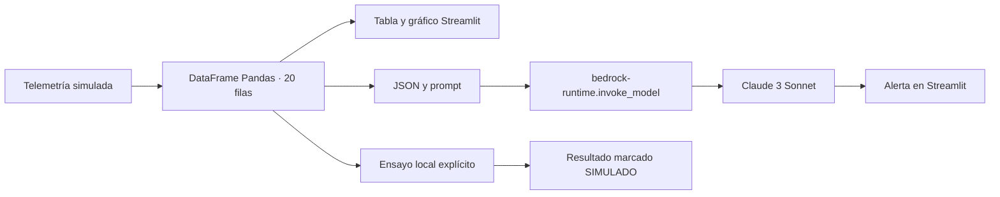

# Aetheris AI

**Entrega 1.1.0:** [guía inglesa](README_EN.md), [estado de cierre](CIERRE.md) y [vídeo final inglés de 1 min 46 s](https://youtu.be/-5itenMafn0), con grabación aportada por el autor y subtítulos ingleses incrustados. Incluye **Alexa+ simulation**, con herramientas locales, traza y seguimiento descargable; está marcada como simulación.

Repositorio público verificado: **https://github.com/Enrickq/aetheris-ai**. **[Proyecto enviado a Devpost](https://devpost.com/software/aetheris-ai)**: la plataforma mostró «Project submitted!» y su vinculación con Build, Ship, Shape el 23 de octubre de 2026, aproximadamente a las 18:28 UTC, antes del cierre. Esto confirma el envío, no una decisión de elegibilidad o del jurado. El vídeo anterior de 2 min 18 s en `demo/` se conserva como respaldo con voz sintética.

MVP para Amazon Hackathon 2026: telemetría astronómica simulada del Roque de los Muchachos y explicación de anomalías con Amazon Bedrock. La aplicación completa está en **`app.py`**; los demás archivos ayudan a instalarla, probarla y presentarla.

## Arranque en Windows

Requisitos: Python 3.11 o posterior, navegador y conexión para instalar las dependencias. El ensayo local funciona sin credenciales AWS una vez instaladas.

Desde PowerShell, en la carpeta de la entrega:

```powershell
.\iniciar.ps1
```

Instalación manual equivalente:

```powershell
py -3 -m venv .venv
.\.venv\Scripts\python.exe -m pip install -r requirements.txt
.\.venv\Scripts\python.exe -m streamlit run app.py
```

Si ya tienes las dependencias en tu entorno:

```powershell
streamlit run app.py
```

Abre la URL local que muestre Streamlit. Para detenerlo, pulsa `Ctrl+C` en la terminal.

El iniciador crea `.venv` e instala `requirements.txt` cuando hace falta. Sus opciones son:

| Opción | Uso |
| --- | --- |
| `-SoloPreparar` | Instala el entorno sin arrancar Streamlit |
| `-PythonExe` | Indica la ruta de Python cuando no está en PATH |
| `-PerfilAWS` | Selecciona el perfil para esta ejecución |
| `-Puerto` | Cambia el puerto local; predeterminado `8501` |

En el equipo de preparación existe el perfil **`aetheris-demo`** en `~/.aws/config`, con región `us-east-1` y salida `json`, **sin credenciales**. Todavía debe autenticarse con la cuenta del evento para probar Bedrock real. Ese archivo local no se incorpora a la entrega. Tras configurar la cuenta:

```powershell
.\iniciar.ps1 -PerfilAWS aetheris-demo
```

## Dos formas de presentar

| Modo | Qué hace | Qué necesitas |
| --- | --- | --- |
| Amazon Bedrock (real), predeterminado | Envía el JSON a Claude 3 Sonnet mediante `boto3` y muestra su respuesta | Credenciales, permiso IAM, acceso al modelo en la región y conexión |
| Ensayo local (sin AWS) | Reproduce la experiencia con un análisis local marcado como simulado | Dependencias instaladas |

Selecciona el modo en el panel lateral. Un error de AWS se muestra como un error operativo; no produce automáticamente un resultado de ensayo. Consulta [AWS_SETUP.md](AWS_SETUP.md) para conectar la cuenta y [DEMO.md](DEMO.md) para el guion de presentación.

## Qué demuestra

| Requisito | Implementación |
| --- | --- |
| Una aplicación Python | Toda la lógica y la UI en `app.py` |
| Streamlit ancho y oscuro | Página `wide`, CSS integrado, tabla y gráfico oscuros |
| Configuración del observatorio | Telescopio, espectro y estación simulados en el lateral |
| Telemetría | DataFrame de 20 filas y cinco columnas, sin base de datos |
| Anomalía visible | Séptima fila: `GTC-007`, luminosidad `9800` u. a. y variación térmica `1250` K |
| Coherencia de datos | Tabla, gráfico y JSON enviado comparten la misma telemetría |
| Integración AWS | Cliente `bedrock-runtime`, operación `invoke_model` |
| Modelo exacto | `anthropic.claude-3-sonnet-20240229-v1:0` |
| Formato de Claude | `anthropic_version`, `max_tokens` y `messages` con bloques de texto |
| Resultado | Alerta destacada; errores de autenticación, acceso y respuesta tratados por separado |
| Evidencia descargable | Telemetría CSV e informe JSON con el origen del análisis |

El informe JSON contiene proyecto y versión, origen (`bedrock` o `ensayo_local`), `telemetria_simulada=true`, modelo, región, análisis, fecha UTC, duración observada de esa operación y los 20 registros. En ensayo local, modelo y región son `null`; su duración no representa la latencia de Bedrock.

## Arquitectura del MVP



La petición real sigue el [formato Messages de Claude en Amazon Bedrock](https://docs.aws.amazon.com/bedrock/latest/userguide/model-parameters-anthropic-claude-messages-request-response.html). La operación exige `bedrock:InvokeModel`, según la [referencia de AWS](https://docs.aws.amazon.com/bedrock/latest/APIReference/API_runtime_InvokeModel.html).

## Alcance y estado de entrega

- La telemetría es sintética; no existe una conexión con un telescopio real.
- El análisis se inicia al pulsar el botón. No hay un flujo continuo de adquisición ni una detección científica validada.
- «Posible Supernova» o «Basura Espacial» es una interpretación para la demo. Estas cinco variables no bastan para confirmar un fenómeno astronómico.
- La entrega no acredita una inferencia real de AWS: esa comprobación requiere una cuenta con acceso al modelo. Las comprobaciones locales con respuestas simuladas no sustituyen esa validación.
- No se incluyen credenciales ni se despliegan recursos cloud con el arranque local. El perfil preparado solo fija región y formato de salida; no concede acceso. Las invocaciones reales se facturan conforme a la cuenta AWS.

El ID solicitado se conserva sin sustitución silenciosa. AWS anuncia EOL el **13 de noviembre de 2026** para Claude 3 Sonnet en determinadas regiones; comprueba región y cuenta antes de la presentación. Consulta el [ciclo de vida de AWS](https://docs.aws.amazon.com/bedrock/latest/userguide/model-lifecycle-legacy.html).

## Verificación reproducible

Con el entorno instalado:

```powershell
.\.venv\Scripts\python.exe -m unittest discover -s tests -v
```

La suite comprueba datos, formato de la petición, procesamiento de respuestas y comportamiento de la UI mediante clientes AWS simulados. No requiere acceso a Bedrock ni genera una inferencia real. Para completar esa comprobación usa los pasos de [AWS_SETUP.md](AWS_SETUP.md).

## Archivos para el jurado

- `app.py`: implementación completa.
- `requirements.txt`: dependencias de ejecución.
- `iniciar.ps1`: iniciador para Windows.
- `DEMO.md`: pitch, guion de 90 segundos y respuestas a preguntas.
- `AWS_SETUP.md` y `iam-policy.json`: conexión y permisos de Bedrock.
- `ENTREGA.md`: ficha del proyecto lista para adaptar al formulario del evento.
- Evidencias y verificaciones incluidas en el paquete de entrega, con su origen indicado.

Consulta [el registro de verificación](evidencias/VERIFICACION.md) y [la captura del ensayo](evidencias/02-alerta-ensayo.png). El ZIP de entrega incluye una lista SHA-256 de sus archivos y excluye el entorno virtual, las cachés y la configuración personal de AWS.

La aplicación se ejecuta localmente; no incluye un despliegue web alojado ni provisión de infraestructura cloud. El código, el vídeo y la candidatura se publican mediante los enlaces indicados arriba.
