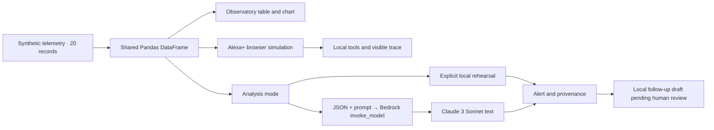

# Aetheris AI · v1.1.0

[English demo video](demo/Aetheris-AI-demo-en.mp4), **2 min 18 s**; [captions](demo/captions_en.srt); [MIT license](LICENSE). The video is an edited walkthrough of the working local simulator, with synthetic English narration. Public video hosting is still pending.

Public source repository: **https://github.com/Enrickq/aetheris-ai**. Code, tests, screenshots, video and reports have been published and compared with the local release.

The complete implementation remains in `app.py`. Tests and release tooling are supporting files. To rebuild the verified ZIP and SHA-256 manifest, run `python tools/build_release.py`.

A working web prototype that turns synthetic observatory telemetry into an understandable alert and a human-reviewed follow-up draft. The **Alexa+ simulation** workspace demonstrates a conversational, tool-driven experience; the **Observatory** workspace exposes the underlying measurements and analysis.

All application code is in **`app.py`**. The project does not connect to Alexa, a microphone, an Echo device, or a real telescope. The Alexa+ experience is explicitly simulated in the browser; it is not an Agent Skill or an MCP server.

## Run on Windows

Use Python 3.11 or later. From PowerShell in this folder:

```powershell
.\iniciar.ps1
```

The launcher creates `.venv`, installs `requirements.txt`, and starts the app on `http://localhost:8501`. Stop it with `Ctrl+C`.

| Launcher option | Purpose |
| --- | --- |
| `-SoloPreparar` | Prepare dependencies without starting the app |
| `-PythonExe` | Supply a Python executable when Python is not on PATH |
| `-PerfilAWS` | Select an existing AWS profile for this run |
| `-Puerto` | Choose a different local port |

Manual installation, without activating the virtual environment:

```powershell
py -3 -m venv .venv
.\.venv\Scripts\python.exe -m pip install -r requirements.txt
.\.venv\Scripts\python.exe -m streamlit run app.py
```

## Run on macOS or Linux

```sh
python3 -m venv .venv
.venv/bin/python -m pip install -r requirements.txt
.venv/bin/python -m streamlit run app.py
```

If dependencies are already installed in your active environment, `streamlit run app.py` is sufficient. Installation needs network access; the local rehearsal works without AWS credentials after installation.

## Reproduce the judging demo

1. In the sidebar, set **Workspace** to **Alexa+ simulation**.
2. Set the analysis mode to **Ensayo local (sin AWS)**. This means “Local rehearsal, without AWS.” It is deliberately distinct from **Amazon Bedrock (real)**, the default analysis mode.
3. Click **Scan the observatory** to inspect a synthetic batch.
4. Click **Explain the anomaly** to obtain the clearly labeled local explanation.
5. Click **Prepare follow-up** to create a local JSON draft with status **`pending_human_review`**. No message is sent and no observation is scheduled.
6. Inspect the conversation, tool trace, and downloadable evidence. Switch to **Observatory** to inspect all 20 measurements and the injected peak in row seven, sector `GTC-007`.

Use [DEMO_EN.md](DEMO_EN.md) for the English recording script. Some original observatory controls and telemetry columns retain Spanish labels; the steps above identify the relevant controls.

## What is real, synthetic, or simulated?

| Component | Current implementation |
| --- | --- |
| Telemetry | 20 deterministic synthetic records; an extreme event is injected in row seven |
| Observatory interface | Working Streamlit table, line chart, analysis action, and exports |
| Alexa+ workspace | Working browser simulation with local orchestration and visible tool traces |
| Local explanation | Deterministic local rule; explicitly labeled simulated |
| Follow-up | Local draft pending human review; no external side effect |
| Bedrock integration | Implemented `boto3` client, `bedrock-runtime.invoke_model`, Claude Messages payload and response parser |
| AWS runtime validation | **Pending**; a successful live Bedrock call has not been established in this delivery |

The astronomy classification is a demo hypothesis, not a validated discovery or an autonomous scientific decision. There is no continuous telescope ingestion, production authentication, or persistent operational database.

## Architecture



The AWS path preserves the requested model ID, `anthropic.claude-3-sonnet-20240229-v1:0`, and uses `anthropic_version="bedrock-2023-05-31"` with `messages`. See the [AWS request/response reference](https://docs.aws.amazon.com/bedrock/latest/userguide/model-parameters-anthropic-claude-messages-request-response.html).

## Enable the real AWS path

Authenticate an AWS profile with access to the requested model and `bedrock:InvokeModel`. On the preparation computer, the profile `aetheris-demo` has only `region=us-east-1` and `output=json`; **it contains no credentials**. Personal AWS configuration is not included in this package.

For an organization using IAM Identity Center, supply the organization's actual SSO details when prompted:

```powershell
aws configure sso --profile aetheris-demo
aws sso login --profile aetheris-demo
.\iniciar.ps1 -PerfilAWS aetheris-demo
```

Choose **Amazon Bedrock (real)** and a region with access for that account. `iam-policy.json` limits invocation to the exact model in `us-east-1`; update its ARN if you choose another region. For a non-Windows shell, select a configured profile with `export AWS_PROFILE=aetheris-demo` before launching the app.

Credentials follow the [standard boto3 provider chain](https://docs.aws.amazon.com/boto3/latest/guide/credentials.html); no keys belong in the code or repository. The original Spanish [AWS_SETUP.md](AWS_SETUP.md) provides additional troubleshooting. AWS errors are displayed as errors, with no automatic substitution of a simulated answer. Real invocations may incur charges.

The requested Claude 3 Sonnet ID is scheduled for retirement in several regions. Verify the account, region, and current [AWS model lifecycle](https://docs.aws.amazon.com/bedrock/latest/userguide/model-lifecycle-legacy.html) before recording a live call.

## Tests and provenance

Windows:

```powershell
.\.venv\Scripts\python.exe -m unittest discover -s tests -v
```

macOS/Linux:

```sh
.venv/bin/python -m unittest discover -s tests -v
```

Tests use mocked AWS responses; they do not verify authorization, model availability, service latency, or cloud cost. The pinned runtime dependencies are Streamlit `1.66.1`, Pandas `3.1.0`, and boto3 `1.43.118`. The preparation environment was inspected with Python `3.12.14`. Refer to the current evidence logs for the checks actually run; screenshots and local rehearsal reports are not AWS runtime proof.

## Submission materials

- [SUBMISSION_EN.md](SUBMISSION_EN.md): copy-ready project description and track disclosure.
- [FEEDBACK_EN.md](FEEDBACK_EN.md): observed product feedback and implementation provenance.
- [DEMO_EN.md](DEMO_EN.md): a roughly two-minute English walkthrough.
- [VOICEOVER_EN.md](VOICEOVER_EN.md): six blocks for recording the author's own narration.
- `tests/`: reproducible local checks.

The intended primary track is the **Alexa+ simulated web experience** path. AWS Builder is an additional integration claim to assess separately: code and documentation exist, while live AWS execution remains unverified. This is not a claim of organizer approval. See the [event overview](https://amazonappdev2026.devpost.com/) and [official rules](https://amazonappdev2026.devpost.com/rules).

**External items still required:** the public English YouTube/Vimeo video URL, team/account fields, and the actual Devpost submission. The author will publish the video. The public GitHub repository and MIT license are already available; no submitted entry is claimed.
